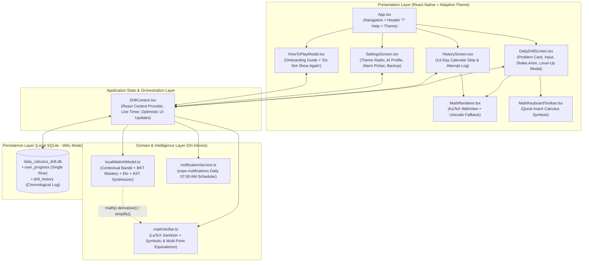
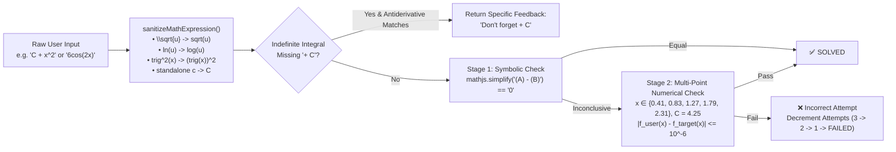

# Daily Calculus Drill 📐 — Technical Specification & Developer Guide

> **Document Type:** System Architecture & Technical Reference Sheet  
> **Application:** Daily Calculus Drill (Cross-Platform Mobile App)  
> **Runtime Stack:** React Native `0.88.1` · Expo SDK `58` · TypeScript `6.0` · SQLite (`expo-sqlite`) · On-Device Neuro-Symbolic AI · `mathjs` CAS  

---

## 1. Executive Summary & Abstract

**Daily Calculus Drill** is a local-first, offline-capable mobile habit tracker and adaptive mathematics training application. Every morning (default `07:00 AM`), the user receives a local system notification prompting them to solve a daily calculus problem (derivative or indefinite integral).

Unlike static flashcard apps or cloud-dependent AI wrappers, **Daily Calculus Drill** runs **100% on-device**:
1. **Local Neuro-Symbolic AI Generator (`src/ai/localMathAIModel.ts`):** Combines a **Contextual Multi-Armed Bandit** topic selector, **Bayesian Knowledge Tracing (BKT)** mastery weights, **Elo Skill Rating (`400`–`2600`)**, and **Symbolic Differentiation (`mathjs`)** to synthesize personalized calculus problems tailored to each user's chosen experience tier (`Beginner`, `Intermediate`, `Advanced`, `Master`).
2. **Computer Algebra Verification (`src/utils/mathVerifier.ts`):** Normalizes human/LaTeX math input and validates algebraic equivalence symbolically (`simplify(user - expected) == 0`) and numerically across deterministic evaluation points—accurately grading equivalent forms such as `C + x^2` vs `x^2 + C` or `e^x(x + 1)` vs `x*e^x + e^x`.
3. **Zero-Cloud SQLite Persistence (`src/database/db.ts`):** Stores user progression, 3-strike attempt states, streak rollovers, AI mastery profiles, onboarding flags, and theme preferences locally in WAL-mode SQLite with one-tap JSON backup/export.

---

## 2. High-Level System Architecture



---

## 3. Technology Stack & Dependencies

| Layer | Package / Module | Version | Technical Role |
| :--- | :--- | :--- | :--- |
| **Core Framework** | `expo` / `react-native` | `~58.0.23` / `0.88.1` | Cross-platform managed workflow runtime (Android, iOS, Web) |
| **Language** | `typescript` | `~6.0.3` | Strict static typing across DB models, AI parameters, and navigation |
| **Local Database** | `expo-sqlite` | `~58.0.15` | Asynchronous SQLite engine (`WAL` journal mode) with versioned schema migrations |
| **Symbolic Math & CAS** | `mathjs` | `^14.0.0` | Symbolic differentiation (`derivative`), algebraic simplification (`simplify`), and compiled expression evaluation (`compile`) |
| **Math Typography** | `react-native-webview` + KaTeX | `14.0.1` | Renders LaTeX equations with crisp typography and instant offline Unicode fallback |
| **Notifications** | `expo-notifications` | `~58.1.8` | Schedules recurring local daily notifications and handles deep-link tap responses |
| **Navigation** | `@react-navigation/native` + `bottom-tabs` | `^7.0.14` | Tab navigation (`DailyDrill`, `History`, `Settings`) and notification deep-linking |

---

## 4. Directory & Module Breakdown

```text
daily-calculus-drill/
├── App.tsx                                 # Root Navigation, Header "?" Button, Theme Provider & Notification Listener
├── app.json                                # Expo SDK 58 configuration & native plugin declarations
├── babel.config.js                         # Babel preset configuration (babel-preset-expo)
├── package.json                            # Dependencies and npm scripts
├── tsconfig.json                           # TypeScript compiler configuration
└── src/
    ├── types/
    │   └── index.ts                        # Central TypeScript interfaces (UserProgress, DrillHistory, CalculusProblem, ThemeMode)
    ├── theme/
    │   └── colors.ts                       # DARK_PALETTE (default) and LIGHT_PALETTE color tokens
    ├── ai/
    │   └── localMathAIModel.ts             # On-device Neuro-Symbolic AI problem generator, Elo rating & BKT mastery updater
    ├── utils/
    │   ├── problemGenerator.ts             # Problem generator facade bridging user level/difficulty to the Local AI engine
    │   └── mathVerifier.ts                 # Input sanitizer, +C detector, symbolic simplifier & numerical equivalence verifier
    ├── database/
    │   └── db.ts                           # SQLite singleton, automatic schema migration (v5), rollover reconciliation & CRUD
    ├── services/
    │   └── notificationService.ts          # Permission handler, Android channel config & daily 07:00 AM scheduler
    ├── context/
    │   └── DrillContext.tsx                # Global state orchestration, 3-attempt lifecycle, timer & theme state
    ├── components/
    │   ├── MathRenderer.tsx                # KaTeX WebView renderer + deterministic Unicode fallback
    │   ├── MathKeyboardToolbar.tsx         # Horizontal quick-insert math symbol bar (+ C, √, π, e^x, ln, trig)
    │   └── HowToPlayModal.tsx              # First-time onboarding popup with "Do not show again" & top-right close button
    └── screens/
        ├── DailyDrillScreen.tsx            # Main puzzle interface, experience selector, attempt counter, shake anim & modals
        ├── HistoryScreen.tsx               # Summary stats, 14-day calendar heatmap strip & chronological attempt list
        └── SettingsScreen.tsx              # Theme radio selector, AI mastery bars, notification time picker, JSON backup & reset
```

---

## 5. Database Architecture & Schema (`src/database/db.ts`)

The application uses an on-device SQLite database (`daily_calculus_drill.db`) running in **Write-Ahead Logging (`PRAGMA journal_mode = WAL`)** mode. Schema upgrades are managed automatically via an idempotent migration runner (`SCHEMA_VERSION = 5`) that executes `safeAddColumn` across app updates and Fast Refresh cycles.

### 5.1. `user_progress` Table (Single-Row State Store)
Constrained by `CHECK (id = 1)` to guarantee exactly one global profile row.

| Column | Type | Default | Description |
| :--- | :--- | :--- | :--- |
| `id` | `INTEGER PRIMARY KEY` | `1` | Enforced single-row key (`CHECK (id = 1)`) |
| `current_level` | `INTEGER NOT NULL` | `1` | Current progression stage; increments `+1` on a solved drill |
| `streak` | `INTEGER NOT NULL` | `0` | Consecutive calendar days solved; resets to `0` on failure or missed day |
| `last_attempt_date` | `TEXT` | `NULL` | Local ISO date string (`YYYY-MM-DD`) of last completed drill |
| `notification_hour` | `INTEGER NOT NULL` | `7` | Daily reminder hour in 24-hour format (`0`–`23`) |
| `notification_minute` | `INTEGER NOT NULL` | `0` | Daily reminder minute (`0`–`59`) |
| `selected_difficulty` | `TEXT NOT NULL` | `'BEGINNER'` | User's chosen experience tier (`'BEGINNER'`, `'INTERMEDIATE'`, `'ADVANCED'`, `'MASTER'`) |
| `skill_rating` | `INTEGER NOT NULL` | `800` | Adaptive Elo-style rating (`400`–`2600`) |
| `topic_mastery_json` | `TEXT NOT NULL` | JSON object | Per-topic mastery probabilities (`0.10`–`0.98`) across 6 calculus domains |
| `hide_onboarding_modal` | `INTEGER NOT NULL` | `0` | `0` = auto-show How-To-Play popup on launch; `1` = suppressed |
| `theme_mode` | `TEXT NOT NULL` | `'DARK'` | UI color theme (`'DARK'` default or `'LIGHT'`) |

### 5.2. `drill_history` Table (Chronological Log)
Stores one unique record per calendar date (`date TEXT NOT NULL UNIQUE`).

| Column | Type | Default | Description |
| :--- | :--- | :--- | :--- |
| `id` | `INTEGER PRIMARY KEY` | `AUTOINCREMENT` | Unique row identifier |
| `date` | `TEXT NOT NULL UNIQUE` | — | Local ISO date (`YYYY-MM-DD`) |
| `level` | `INTEGER NOT NULL` | — | Level attempted on that date |
| `problem_latex` | `TEXT NOT NULL` | — | LaTeX problem statement (e.g., `\int 6x^2 \, dx`) |
| `correct_answer` | `TEXT NOT NULL` | — | Canonical `mathjs` expression (e.g., `2*x^3 + C`) |
| `user_answer` | `TEXT NOT NULL` | `''` | Last expression submitted by the user |
| `status` | `TEXT NOT NULL` | `'PENDING'` | `'PENDING'` \| `'SOLVED'` \| `'FAILED'` \| `'SKIPPED'` |
| `solved_at` | `TEXT` | `NULL` | ISO-8601 completion timestamp |
| `attempts_used` | `INTEGER NOT NULL` | `0` | Number of attempts used (`0` to `3`) |
| `duration_seconds` | `INTEGER` | `0` | Active time spent solving the drill in seconds |
| `category` | `TEXT` | `NULL` | Human-readable category tag |
| `hint` | `TEXT` | `NULL` | Step-by-step calculus hint generated for the problem |
| `ai_reasoning` | `TEXT` | `NULL` | Explanation of why the Local AI generated this problem |
| `difficulty` | `TEXT` | `NULL` | Experience tier under which the problem was synthesized |
| `topic_key` | `TEXT` | `NULL` | Internal topic identifier (`polynomial`, `trig`, `exponential`, etc.) |

---

## 6. Core Algorithms & Workflows

### 6.1. On-Device Neuro-Symbolic AI Question Generator (`src/ai/localMathAIModel.ts`)
Instead of relying on static question lists or paid external LLM APIs, the app uses a 3-stage local neuro-symbolic pipeline:

1. **Experience Tier Filtering (`DIFFICULTY_PROFILES`):**
   - **Beginner (`Base Elo 800`):** `polynomial` (Power rule derivatives & basic polynomial integrals, coefficients `1..5`, exponents `1..4`).
   - **Intermediate (`Base Elo 1150`):** `polynomial`, `trig`, `exponential`, `logarithmic` (coefficients `2..8`, powers `1..5`).
   - **Advanced (`Base Elo 1500`):** `trig`, `exponential`, `logarithmic`, `product_quotient` (Product rule, Quotient rule, and $u$-substitution integrals).
   - **Master (`Base Elo 1850`):** `product_quotient`, `chain_by_parts`, `trig`, `exponential` (Integration by Parts $\int kx e^x dx$, $\int k\ln(x) dx$, and nested Chain Rule composites).

2. **Contextual Bandit Topic Selection (`selectTargetTopicWithAI`):**
   For each allowed topic $t$ in the user's selected difficulty tier, the AI computes a utility score combining **weakness targeting**, **recency penalty**, and **exploration noise** ($\epsilon \in [0, 0.25]$ using a seeded Mulberry32 PRNG):
   $$U(t) = 0.75 \cdot (1 - M_t) - 0.15 \cdot \mathbb{I}(t = t_{\text{prev}}) + \epsilon$$
   where $M_t \in [0.10, 0.98]$ is the user's stored mastery score for topic $t$. Topics with lower mastery receive higher priority.

3. **Symbolic Expression Synthesis & Adaptation (`updateSkillModelAfterAttempt`):**
   - Coefficients and exponents scale proportionally with `skill_rating`.
   - Symbolic derivatives are computed on-device via `mathjs.simplify(mathjs.derivative(expr, 'x'))`.
   - After completion, `skill_rating` ($R$) and topic mastery ($M_t$) update based on accuracy, attempts used ($a \in \{1,2,3\}$), and solve duration ($d$):
     $$\Delta R = \begin{cases} \text{round}(28 \cdot \alpha_a \cdot \beta_d) & \text{if SOLVED} \\ -22 & \text{if FAILED} \end{cases}$$
     where $\alpha_a \in \{1.0, 0.65, 0.35\}$ rewards first-attempt solves and $\beta_d \in \{1.2, 1.0, 0.8\}$ rewards solves under 35 seconds.

---

### 6.2. Algebraic Equivalence Verification (`src/utils/mathVerifier.ts`)
Grading free-form calculus input requires verifying mathematical equivalence rather than string matching:



---

### 6.3. 3-Attempt Rule, Day Rollover & Streak Lifecycle
1. **Within a Daily Drill:**
   - Every problem starts with `attempts_used = 0` (**`Attempts Remaining: 3 / 3`**).
   - Submitting a non-empty wrong answer triggers a horizontal error shake animation (`Animated.sequence`) and increments `attempts_used`:
     - **Attempt 1 wrong:** `2 / 3` attempts remaining (`PENDING`)
     - **Attempt 2 wrong:** `1 / 3` attempt remaining (`PENDING`)
     - **Attempt 3 wrong (or "Give Up"):** `0 / 3` attempts remaining → status becomes `'FAILED'`, `streak` resets to `0`, `current_level` stays unchanged, and the **Canonical Solution** card is revealed with options to **Retry** or **Generate Next Adaptive AI Problem**.
   - Submitting a correct answer on Attempt 1, 2, or 3 sets status to `'SOLVED'`, increments `current_level + 1` and `streak + 1`, updates AI Skill Elo, and opens the **Level Up! 🎉** modal.
2. **Midnight / Day Rollover (`reconcileDailyRollover`):**
   - On app launch or when returning to the foreground on a new calendar day, any prior date left in `'PENDING'` status is automatically marked `'FAILED'`, and if more than 1 calendar day has elapsed since `last_attempt_date`, `streak` resets to `0`.

---

## 7. Developer Setup & Commands

```bash
# 1. Install dependencies
npm install

# 2. Run TypeScript static verification
npm run typecheck

# 3. Start Expo Metro Bundler (clear cache)
npx expo start -c
```
